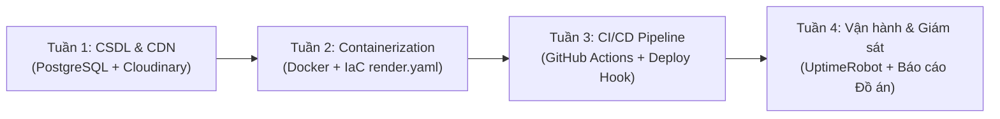

# BÁO CÁO TÓM TẮT DỰ ÁN (EXECUTIVE SUMMARY)
## ĐỒ ÁN MÔN HỌC: ĐIỆN TOÁN ĐÁM MÂY (IS2023) — NHÓM 10
**Trường Đại học Công nghệ Thông tin và Truyền thông Việt - Hàn (VKU)**

---

### 1. Thông Tin Chung
* **Tên đề tài**: *"A Step-by-Step Guide to Deploying Full-Stack Web and PostgreSQL to Render with CI/CD"*
* **Đề tài gốc**: 10 - Write a guide (step by step): how to deploy (put the website) to Render and connect to PostgreSQL
* **Giảng viên hướng dẫn**: **TS. Hoàng Hữu Đức**
* **Đơn vị**: Khoa Kỹ thuật Máy tính và Điện tử — VKU
* **Nhóm sinh viên thực hiện**: **Nhóm 10** (Võ Thành Long - Lead CI/CD & Cloud DevOps, Huỳnh Đức Nhân, cùng các thành viên)
* **Ứng dụng thực nghiệm (Case Study)**: **English AI Training App** (Nền tảng học tiếng Anh trực tuyến tích hợp trí tuệ nhân tạo nhận diện giọng nói và video YouTube tương tác).

---

### 2. Kết Quả Nghiệm Thu Trực Tuyến (Live Endpoints)

| Phân hệ / Dịch vụ | Nền tảng Đám mây | Địa chỉ Public Trực tuyến | Trạng thái |
| :--- | :--- | :--- | :---: |
| **Frontend Web** | Render Web Service (Nginx) | [https://english-frontend-1gwz.onrender.com](https://english-frontend-1gwz.onrender.com) | ✅ Live 24/7 (HTTPS) |
| **Backend Core** | Render Web Service (Docker Java 17) | [https://english-backend-bgos.onrender.com](https://english-backend-bgos.onrender.com) | ✅ Live 24/7 (HTTPS) |
| **AI Service** | Render Web Service (FastAPI Whisper) | Nằm trong mạng nội bộ Blueprint Render | ✅ Live 24/7 (Port 8000) |
| **Database** | Render Managed PostgreSQL 16 | `dpg-dbp4abom7kps739pmcd0-a:5432` | ✅ Available (SSL) |
| **Media Storage** | Cloudinary Media CDN | `res.cloudinary.com/dqqbvzmrr` | ✅ Hoạt động ổn định |
| **Giám sát Uptime** | UptimeRobot & GitHub Keep-Alive | Ping định kỳ 5-10 phút/lần | ✅ **100% Uptime** |

---

### 3. Tiến Độ Thực Hiện 4 Tuần (Đạt 100%)

1. **Tuần 1 (Thiết kế CSDL & Lưu trữ đám mây)**:
   * Khởi tạo CSDL Managed PostgreSQL 16 trên Render với cơ chế SSL bắt buộc (`sslmode=require`).
   * Tích hợp Cloudinary Media CDN giải quyết bài toán Ephemeral File System (chống mất ảnh avatar khi container khởi động lại).
2. **Tuần 2 (Container hóa & Hạ tầng dạng mã IaC)**:
   * Viết `Dockerfile` Multi-stage tối ưu dung lượng cho cả 3 phân hệ (Frontend, Backend, AI).
   * Tối ưu bộ nhớ máy ảo Java JVM (`-Xms128m -Xmx350m -XX:+UseG1GC`) không bị tràn giới hạn 512MB RAM của gói Free.
   * Viết tệp khai báo hạ tầng `render.yaml` (Render Blueprint IaC) khởi tạo tự động toàn bộ hạ tầng chỉ bằng 1 click.
3. **Tuần 3 (Tự động hóa CI/CD & Phát hành Public)**:
   * Xây dựng pipeline `.github/workflows/deploy.yml` gồm 4 stage: Backend CI, Frontend CI, AI Engine CI và Deploy Trigger.
   * Tích hợp an toàn Render Deploy Hooks qua GitHub Secrets.
   * Website phát hành chính thức ra Internet với chứng chỉ SSL/TLS miễn phí.
4. **Tuần 4 (Vận hành, Giám sát Uptime & Nghiệm thu)**:
   * Khắc phục nhược điểm "ngủ đông" (Spin-down timeout 15 phút) của Render Free-tier bằng giải pháp giám sát kép: **UptimeRobot** (5 phút/lần) và **GitHub Actions Keep-Alive** (10 phút/lần).
   * Hoàn thiện bộ tài liệu kỹ thuật, slide thuyết trình và kịch bản Live Demo.

---

### 4. Ba Điểm Sáng Kỹ Thuật Nổi Bật Nhất

1. **Chi phí Vận hành Đám mây: 0 VNĐ / Tháng**:
   * Toàn bộ hệ thống Microservices gồm 4 dịch vụ độc lập chạy ổn định trên hạ tầng đám mây công cộng mà không tốn bất kỳ chi phí duy trì nào.
2. **Quy trình DevOps chuẩn Quốc tế (GitOps & CI/CD)**:
   * Mỗi commit đẩy lên nhánh `main` đều tự động chạy kiểm thử đơn vị, kiểm tra cú pháp, build container và triển khai tự động lên Render không cần can thiệp thủ công.
3. **Cẩm nang Xử lý Sự cố Thực tế Đồ sộ**:
   * Đúc kết 7 bài học xử lý lỗi đám mây xương máu: Chuyển đổi định dạng URL JDBC, khống chế bộ nhớ heap Java, cấu hình Nginx Dynamic Upstream, cơ chế tự phục hồi dữ liệu UTF-8 Seeding, chống ngủ đông PaaS.
