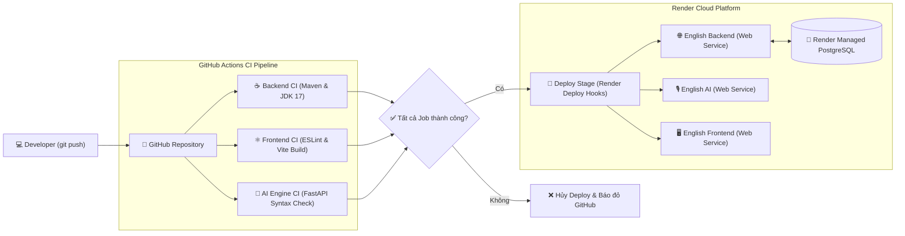

# HƯỚNG DẪN THIẾT LẬP LUỒNG CI/CD PIPELINE VỚI GITHUB ACTIONS & RENDER
## Đồ án môn học: Điện toán đám mây (IS2023) — Nhóm 10
### Đề tài: A Step-by-Step Guide to Deploying Full-Stack Web and PostgreSQL to Render with CI/CD
**Hệ thống thực nghiệm:** English Training App (Spring Boot 3 + FastAPI Whisper + React 18 + PostgreSQL Managed)  
**Chủ trì Kỹ thuật Tuần 3:** Long (Lead CI/CD & DevOps Tester)

---

## 1. Giới thiệu tổng quan về CI/CD

Trong mô hình phát triển phần mềm hiện đại, **CI/CD** là xương sống giúp chuyển giao phần mềm nhanh chóng, tin cậy và liên tục:
- **CI (Continuous Integration - Tích hợp liên tục):** Tự động hóa quá trình kiểm thử (Unit test, Linting, Compile, Build artifact) ngay khi lập trình viên tạo Pull Request hoặc đẩy mã nguồn (`git push`) lên nhánh chung. Giúp phát hiện xung đột và lỗi cú pháp ngay lập tức.
- **CD (Continuous Deployment / Delivery - Triển khai liên tục):** Sau khi các bước CI hoàn thành thành công (pass 100%), hệ thống tự động kích hoạt cơ chế phát hành ứng dụng lên môi trường điện toán đám mây (PaaS Render) thông qua **Render Deploy Hooks**, không yêu cầu bất kỳ thao tác thủ công nào từ phía quản trị viên.



---

## 2. Chuẩn bị trước khi thiết lập (Prerequisites)

1. **Tài khoản Render & GitHub**:
   - Repository mã nguồn đã được đưa lên GitHub (ví dụ: `https://github.com/A-Phien/english_training_app`).
   - Tài khoản Render đã tạo Blueprint hoặc các dịch vụ từ tệp `render.yaml`.
2. **Quyền hạn**:
   - Quyền Admin hoặc Maintainer trên GitHub Repository để cấu hình **Repository Secrets**.
   - Quyền quản trị trên Render Dashboard để lấy đường dẫn **Deploy Hook**.

---

## 3. Bước 1: Lấy Deploy Hook URL từ Render Dashboard

Render cung cấp tính năng **Deploy Hook** — một URL endpoint độc nhất có chứa token xác thực. Mỗi khi gửi một HTTP POST request tới URL này, Render sẽ lập tức kéo mã nguồn mới nhất từ GitHub và thực hiện rebuild container mà không làm gián đoạn người dùng (Zero Downtime Deployment).

### Hướng dẫn thao tác từng bước:
1. Đăng nhập vào [Render Dashboard](https://dashboard.render.com).
2. Nhấp vào dịch vụ cần lấy hook (ví dụ: **`english-backend`**).
3. Tại menu bên trái, chọn tab **Settings**.
4. Cuộn xuống mục **Deploy Hook**.
5. Nhấp vào nút **Create Deploy Hook** (hoặc **Add Deploy Hook**).
6. Đặt tên gợi nhớ (ví dụ: `GitHub Actions CI Hook`).
7. Render sẽ sinh ra một đường dẫn HTTPS bí mật có dạng:
   ```text
   https://api.render.com/deploy/srv-c1234567890abcdef?key=xyz123abc456
   ```
8. Nhấp vào biểu tượng **Copy** và lưu tạm đường dẫn này.
9. Lặp lại thao tác trên cho **`english-frontend`** và **`english-ai`** để lấy đủ 3 Deploy Hook URLs.

> [!CAUTION]
> **Cực kỳ quan trọng về bảo mật**: Không bao giờ commit URL chứa secret key của Deploy Hook trực tiếp vào mã nguồn Git công khai. Bất kỳ ai có URL này đều có thể kích hoạt build liên tục làm cạn kiệt hạn ngạch tài nguyên (Build Minutes) trên Render của bạn.

---

## 4. Bước 2: Thiết lập GitHub Repository Secrets

Để bảo vệ các Deploy Hook URLs, ta sử dụng tính năng **GitHub Actions Secrets** (mã hóa chuẩn asymmetric encryption của GitHub).

### Hướng dẫn thiết lập trên GitHub:
1. Truy cập vào GitHub Repository của dự án:  
   `https://github.com/<owner>/<repo>/settings/secrets/actions`
2. Nhấp vào nút **New repository secret**.
3. Khởi tạo lần lượt 3 secret tương ứng với 3 dịch vụ:

| Tên Secret (Name) | Giá trị (Value) | Mô tả |
| :--- | :--- | :--- |
| `RENDER_BACKEND_DEPLOY_HOOK` | `https://api.render.com/deploy/srv-xxx?key=yyy` | Hook kích hoạt deploy Spring Boot Core |
| `RENDER_FRONTEND_DEPLOY_HOOK` | `https://api.render.com/deploy/srv-xxx?key=yyy` | Hook kích hoạt deploy React Nginx Client |
| `RENDER_AI_DEPLOY_HOOK` | `https://api.render.com/deploy/srv-xxx?key=yyy` | Hook kích hoạt deploy FastAPI AI Engine |

4. Nhấp **Add secret** để lưu lại. Sau khi lưu, GitHub sẽ ẩn hoàn toàn giá trị bí mật và chỉ hiển thị tên.

---

## 5. Bước 3: Cấu trúc tệp Workflow GitHub Actions (`.github/workflows/deploy.yml`)

Tệp workflow được đặt tại thư mục `.github/workflows/deploy.yml`. Cấu trúc bao gồm 4 jobs chạy song song và tuần tự:

```yaml
name: CI/CD Pipeline - English Training App

on:
  push:
    branches:
      - main
      - master
  pull_request:
    branches:
      - main
      - master
  workflow_dispatch:

jobs:
  # ────────────────────────────────────────────────────────────────────────────
  # Job 1: Kiểm thử Backend Spring Boot
  # ────────────────────────────────────────────────────────────────────────────
  backend-ci:
    name: Backend CI (Spring Boot 3)
    runs-on: ubuntu-latest
    steps:
      - name: Checkout Source Code
        uses: actions/checkout@v4

      - name: Set up JDK 17
        uses: actions/setup-java@v4
        with:
          java-version: '17'
          distribution: 'temurin'
          cache: maven

      - name: Grant Execute Permission to Maven Wrapper
        run: chmod +x backend-core/backend-core/mvnw

      - name: Compile and Test Backend
        run: |
          cd backend-core/backend-core
          ./mvnw clean test-compile

      - name: Package Backend Jar
        run: |
          cd backend-core/backend-core
          ./mvnw -B package -DskipTests

  # ────────────────────────────────────────────────────────────────────────────
  # Job 2: Kiểm thử Frontend React + Vite
  # ────────────────────────────────────────────────────────────────────────────
  frontend-ci:
    name: Frontend CI (React 18 + Vite)
    runs-on: ubuntu-latest
    steps:
      - name: Checkout Source Code
        uses: actions/checkout@v4

      - name: Set up Node.js 20
        uses: actions/setup-node@v4
        with:
          node-version: '20'
          cache: 'npm'
          cache-dependency-path: frontend-client/package-lock.json

      - name: Install Frontend Dependencies
        run: |
          cd frontend-client
          npm ci

      - name: Run ESLint
        run: |
          cd frontend-client
          npm run lint

      - name: Build Frontend Distribution
        run: |
          cd frontend-client
          npm run build

  # ────────────────────────────────────────────────────────────────────────────
  # Job 3: Kiểm thử AI Engine FastAPI
  # ────────────────────────────────────────────────────────────────────────────
  ai-engine-ci:
    name: AI Engine CI (FastAPI)
    runs-on: ubuntu-latest
    steps:
      - name: Checkout Source Code
        uses: actions/checkout@v4

      - name: Set up Python 3.11
        uses: actions/setup-python@v5
        with:
          python-version: '3.11'
          cache: 'pip'
          cache-dependency-path: ai-engine/requirements.txt

      - name: Install Dependencies & Check Syntax
        run: |
          cd ai-engine
          python -m pip install --upgrade pip
          pip install -r requirements.txt
          python -m py_compile main.py

  # ────────────────────────────────────────────────────────────────────────────
  # Job 4: Kích hoạt Triển khai Tự động sang Render
  # ────────────────────────────────────────────────────────────────────────────
  deploy-render:
    name: Deploy to Render via Deploy Hooks
    needs: [backend-ci, frontend-ci, ai-engine-ci]
    if: github.ref == 'refs/heads/main' && (github.event_name == 'push' || github.event_name == 'workflow_dispatch')
    runs-on: ubuntu-latest
    steps:
      - name: Trigger Backend Deploy Hook
        if: env.RENDER_BACKEND_DEPLOY_HOOK != ''
        env:
          RENDER_BACKEND_DEPLOY_HOOK: ${{ secrets.RENDER_BACKEND_DEPLOY_HOOK }}
        run: |
          echo "🚀 Kích hoạt Deploy Hook cho english-backend..."
          curl -X POST "$RENDER_BACKEND_DEPLOY_HOOK" -o /dev/null -s -w "%{http_code}\n" | grep -E "(200|201)" || echo "⚠️ Backend deploy hook returned non-200 or pending."

      - name: Trigger AI Engine Deploy Hook
        if: env.RENDER_AI_DEPLOY_HOOK != ''
        env:
          RENDER_AI_DEPLOY_HOOK: ${{ secrets.RENDER_AI_DEPLOY_HOOK }}
        run: |
          echo "🚀 Kích hoạt Deploy Hook cho english-ai..."
          curl -X POST "$RENDER_AI_DEPLOY_HOOK" -o /dev/null -s -w "%{http_code}\n" | grep -E "(200|201)" || echo "⚠️ AI Engine deploy hook returned non-200 or pending."

      - name: Trigger Frontend Deploy Hook
        if: env.RENDER_FRONTEND_DEPLOY_HOOK != ''
        env:
          RENDER_FRONTEND_DEPLOY_HOOK: ${{ secrets.RENDER_FRONTEND_DEPLOY_HOOK }}
        run: |
          echo "🚀 Kích hoạt Deploy Hook cho english-frontend..."
          curl -X POST "$RENDER_FRONTEND_DEPLOY_HOOK" -o /dev/null -s -w "%{http_code}\n" | grep -E "(200|201)" || echo "⚠️ Frontend deploy hook returned non-200 or pending."
```

---

## 6. Bước 4: Kiểm thử Kích hoạt Thực tế (Trigger & Verification)

Để xác nhận hệ thống CI/CD vận hành chính xác:

1. **Tạo commit kiểm thử**:
   Chỉnh sửa một dòng nhỏ trên giao diện (ví dụ: dòng thông tin footer tại `frontend-client/src/Layout/Footer.jsx` thành `Eng-Lab • Nhóm 10 - Điện toán đám mây VKU (v1.3-ci-ready)`).
2. **Đẩy mã nguồn lên GitHub**:
   ```bash
   git add .
   git commit -m "ci(deploy): configure GitHub Actions CI/CD pipeline and test trigger"
   git push origin main
   ```
3. **Theo dõi trên giao diện GitHub Actions**:
   - Truy cập tab **Actions** trên GitHub.
   - Quan sát 3 job `Backend CI`, `Frontend CI`, `AI Engine CI` chạy song song với icon vàng xoay tròn.
   - Khi cả 3 job hoàn tất với **dấu tích xanh (Green Checkmark)**, job `Deploy to Render` sẽ tự động kích hoạt.
4. **Theo dõi trên giao diện Render Dashboard**:
   - Render sẽ ghi nhận sự kiện: `Deploy triggered by hook`.
   - Quá trình build và deploy container mới bắt đầu tự động.
   - Sau ~2-3 phút, trạng thái chuyển sang **Live**.
5. **Kiểm tra trên trình duyệt**:
   - Mở URL công khai của Frontend trên Render (giao thức HTTPS).
   - Cuộn xuống chân trang để xác nhận dòng chữ version mới đã cập nhật.

---

## 7. Cẩm nang Xử lý Sự cố thường gặp (Troubleshooting)

### Sự cố 1: Lỗi quyền thực thi tệp Maven Wrapper (`Permission denied: ./mvnw`)
- **Triệu chứng**: GitHub Actions dừng đột ngột tại bước Backend CI với thông báo `bash: ./mvnw: Permission denied`.
- **Nguyên nhân**: Khi làm việc trên Windows, cờ phân quyền thực thi `executable bit (+x)` của hệ điều hành Linux không được lưu vào Git.
- **Giải pháp**: 
  - Bổ sung bước `chmod +x backend-core/backend-core/mvnw` trực tiếp vào workflow trước khi gọi `./mvnw`.
  - Hoặc chạy lệnh trên terminal local trước khi push: `git update-index --chmod=+x backend-core/backend-core/mvnw`.

### Sự cố 2: Lỗi ESLint v9 Flat Config làm đứt luồng CI (`npm run lint`)
- **Triệu chứng**: Frontend CI fail do các cảnh báo unused vars hoặc các rule thực nghiệm React Hooks (`react-hooks/set-state-in-effect`).
- **Nguyên nhân**: Môi trường CI mặc định coi mọi error trong ESLint là fatal exit code 1.
- **Giải pháp**: Chuẩn hóa tệp `eslint.config.js`, tắt các rule thực nghiệm chưa tương thích (`'react-hooks/set-state-in-effect': 'off'`) và dọn dẹp các biến thừa trong components.

### Sự cố 3: Deploy Hook trả về mã lỗi 404 hoặc không phản hồi
- **Triệu chứng**: Job Deploy báo `⚠️ deploy hook returned non-200`.
- **Nguyên nhân**: 
  - Secret trên GitHub chưa được cấu hình hoặc tên secret trong workflow không khớp với GitHub Secrets.
  - Render Deploy Hook bị xoá hoặc regenerate trên Dashboard mà chưa cập nhật lại trên GitHub.
- **Giải pháp**: Kiểm tra lại tab **Settings > Secrets and variables > Actions** trên GitHub, đảm bảo giá trị secret bắt đầu bằng `https://api.render.com/deploy/...`.

